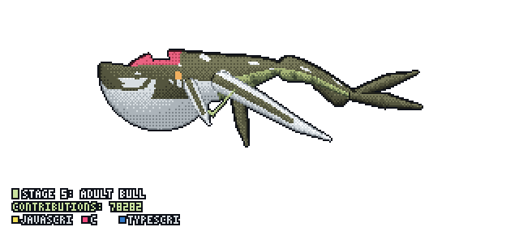

 

**Building software across the stack — from systems and AI infrastructure to production web and mobile applications.**

 

<table align="center">
<tr>
<td align="center">🎓 <b>Studying</b> Physics &amp; Computer Science University of Ghana, Legon</td>
<td align="center">🧩 <b>Leading</b> LucidLabs Student engineering team</td>
<td align="center">🧠 <b>Exploring</b> AI Infrastructure &amp; Agents Local + cloud LLM systems</td>
<td align="center">🐧 <b>Driving</b> Arch Linux btw</td>
</tr>
</table>

 

## About

I'm a Physics & Computer Science student at the **University of Ghana** who works across the layers most developers don't usually touch together — **systems, artificial intelligence, distributed applications, and product engineering**.

I lead **LucidLabs**, a student engineering team building client software, and split my time between React/Firebase-backed products, local LLM inference, multi-agent orchestration, and backend architecture.

I run **Arch Linux** as a daily driver and prefer understanding how things work beneath the abstraction rather than treating the abstraction as the whole system. My current focus is on building software that is **useful, resilient, and capable of operating under real-world constraints**.

 

## Engineering Stack

 

| Domain | Technologies |
| :--- | :--- |
| **Systems & AI** | Arch Linux · PyTorch · C++ · Java |
| **AI Infrastructure** | Python · Ollama · Hugging Face · Groq |
| **Backend** | Node.js · Express.js · Django · PHP |
| **Frontend** | React · Angular · HTML5 · CSS3 |
| **Mobile** | Flutter · Swift · Kotlin |
| **Data & Infrastructure** | PostgreSQL · MySQL · Docker · Kubernetes |
| **Design & Product** | Figma · Lunacy |

 

## Selected Projects

<table>
<tr>
<td width="50%" valign="top">

<h3>🧪 Project ATOM</h3>
<strong>UG Chemistry Student Hub · LucidLabs</strong>

Full-stack platform built for the University of Ghana Chemistry Department (CHEMSA-UG), replacing fragmented paper and messaging workflows with a centralized system — lab session booking with live capacity tracking, deadline enforcement, resource distribution, announcements, complaint management, and Paystack-powered souvenir purchases.

<a href="https://atom-5cb26.web.app">Live App →</a> ·
<a href="https://youtu.be/938bIR7If8E">Student Demo →</a> ·
<a href="https://youtu.be/J3bfXq46BFM">Admin Demo →</a>

</td>
<td width="50%" valign="top">

<h3>🤖 Multi-LLM Orchestrator</h3>
<strong>Local AI Router · Personal Project</strong>

A Node.js AI routing system for environments where latency, hardware limits, and network availability matter — dynamically deciding whether a query goes to Groq for fast cloud inference, Hugging Face for broader model access, or local Ollama for offline inference, based on query complexity and network conditions.

</td>
</tr>
<tr>
<td width="50%" valign="top">

<h3>💎 Chekki</h3>
<strong>Digital Business Platform · Lead Architect</strong>

A platform helping small businesses establish a serious digital presence without enterprise-software complexity. Owned architecture and full-stack development across business discovery, profiles, reviews, digital storefront functionality, and cloud-backed infrastructure.

<a href="https://chekki-1.web.app">Explore Chekki →</a>

</td>
<td width="50%" valign="top">

<h3>⛪ The Gathering Place</h3>
<strong>Community Platform · Full-Stack Developer</strong>

A real-time digital community platform for a geographically distributed congregation — live broadcasts, announcements, shared resources, community communication, and administrative content management.

<a href="https://thegatheringplace-app.web.app">Visit App →</a>

</td>
</tr>
<tr>
<td width="50%" valign="top">

<h3>📡 ScriptOps</h3>
<strong>Multi-Agent Screenplay Pipeline · LucidLabs</strong>

An agentic AI pipeline built for the Google Cloud Agentic Cinema Hackathon. Coordinates specialized AI agents to turn a screenplay into a structured production package — scene breakdowns, shot lists, casting suggestions, budget estimates, and production planning — through an orchestration layer that manages the flow end to end.

</td>
<td width="50%" valign="top">

<h3>💬 WhatsApp AI Auto-Responder</h3>
<strong>Open Source · Personal Project</strong>

A self-hosted WhatsApp auto-responder pairing Baileys with Groq for fast LLM replies, controlled through a companion Flutter dashboard.

<a href="https://github.com/1mos-droid/whatsapp-auto-responder">View Repo →</a>

</td>
</tr>
</table>

 

## Currently Building

| Area | Project |
| :--- | :--- |
| 🎬 Multi-agent AI systems | ScriptOps |
| 🧠 LLM infrastructure | Local AI routing |
| 🧮 Algorithms & data structures | Java + Levitin |
| 🖥️ Human-computer interaction | UG iEnabler redesign |
| 📱 Production software | Full-stack systems, church member app |

 

## Engineering Interests

<table>
<tr>
<td>🤖 Artificial Intelligence &amp; Agentic Systems</td>
<td>⚙️ Systems Programming</td>
</tr>
<tr>
<td>🧩 LLM Infrastructure &amp; Local Inference</td>
<td>🌐 Distributed Systems</td>
</tr>
<tr>
<td>🏗️ Backend Architecture</td>
<td>🛠️ Developer Infrastructure</td>
</tr>
<tr>
<td>🖥️ Human-Computer Interaction</td>
<td>📦 Full-Stack Product Engineering</td>
</tr>
</table>

I like working where multiple layers meet — where software architecture, infrastructure, AI, and product design have to work together rather than independently.

 

## GitHub Analytics

 

 

 

 

<h3>Build. Understand. Iterate.</h3>

<i>Always learning. Always building.</i>

 

  

